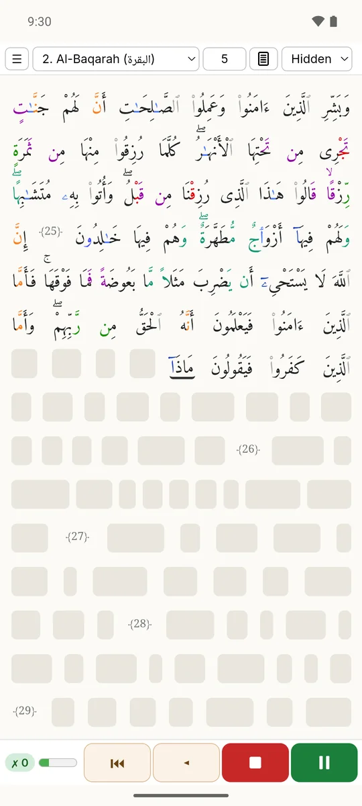
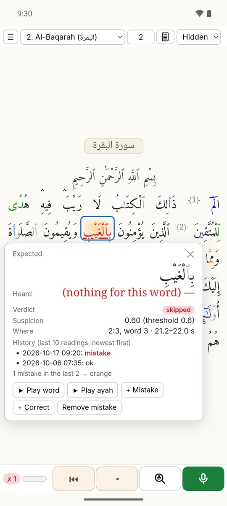
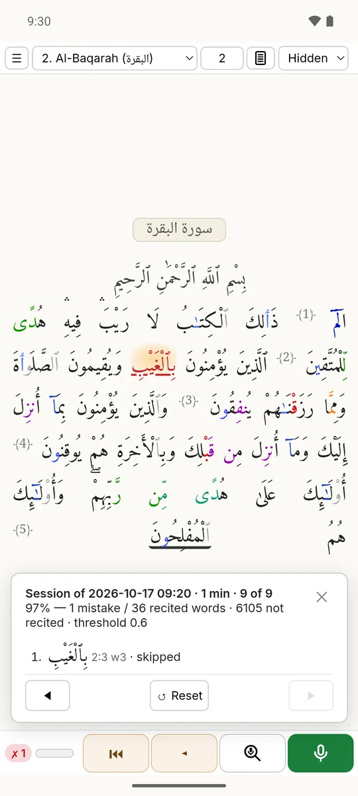
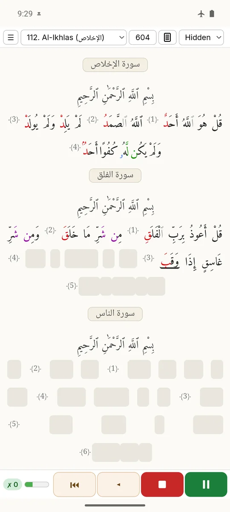
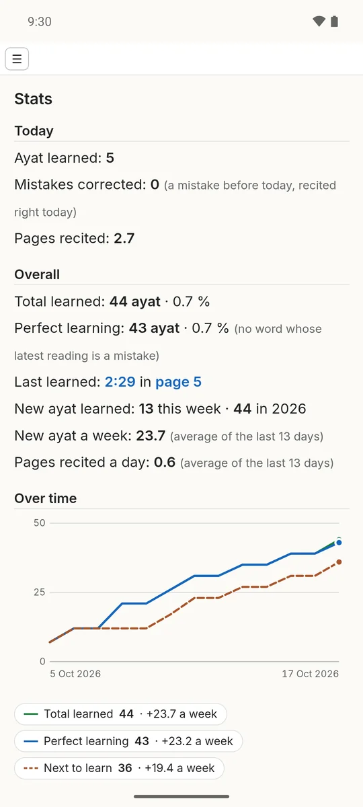
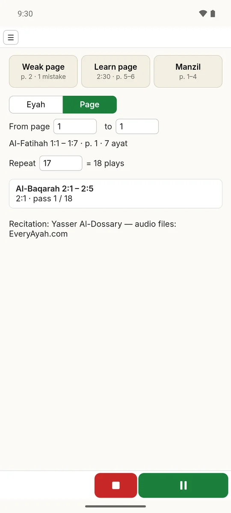

# Meddeb (web)

Meddeb, a local and private Qur'an recitation coach. Website: https://karim-53.github.io/Meddeb/

- `index.html`, `privacy.html`, `impressum.html`, `site.css`, `favicon.svg` - the GitHub Pages site (served from `main`, root).
- `screenshots/` - the pictures of Meddeb for Android shown on the site and below (made on the emulator with a demo
  profile by the private dev repo's `tools/make_screenshots.py`).
- `download.html` - the Android download page; `update.json` - what the Android app checks for its updates (written
  only by `android/tools/publish_release.ps1` from the built APK; the APK itself is a GitHub Release asset of this
  repository, tag `android-vX.Y`, file `meddeb_vX.Y.apk`).
- `models/` - the phone models re-hosted for the Meddeb apps (parts + manifest; see each folder's README and LICENSE).
- `LICENSE.md` - the licences of this repository; `THIRD_PARTY_NOTICES.md` and `licenses/` - the third-party notices and licence texts of the Meddeb apps (copies of the app's files).
- Bugs and ideas: [open an issue](https://github.com/Karim-53/Meddeb/issues/new/choose).

## Screenshots

<table>
<tr>
<td align="center" width="33%"> <b>Recite from memory</b> Meddeb follows you word by word on the mushaf page; in Hidden mode, each word appears as you say it.</td>
<td align="center" width="33%"> <b>Mistakes caught</b> A skipped or changed word turns red: tap it to hear your own recording and correct the verdict in one tap.</td>
<td align="center" width="33%"> <b>A summary after each session</b> Your score and every mistake in one list, with your past sessions one tap away.</td>
</tr>
<tr>
<td align="center" width="33%"> <b>Offline and private</b> After a one-time model download, the recognition runs on your phone, even in airplane mode: no account, and your voice never leaves the phone.</td>
<td align="center" width="33%"> <b>Your progress</b> The ayat you learned today and overall, your weekly pace, and a chart of your progress day by day.</td>
<td align="center" width="33%"> <b>Listen</b> Yasser Al-Dossary recites your weakest page, the next ayah to learn or your manzil, as often as you like, with the screen off or in the car.</td>
</tr>
</table>

Meddeb 0.12 for Android with a demo profile. Qur'an text: <a href="https://tanzil.net">Tanzil Project</a>
(CC BY 3.0, unchanged); page layout and tajweed colours: QUL (Tarteel) and Quran.com; see
<a href="THIRD_PARTY_NOTICES.md">THIRD_PARTY_NOTICES.md</a>. The same pictures as a slideshow:
https://karim-53.github.io/Meddeb/
